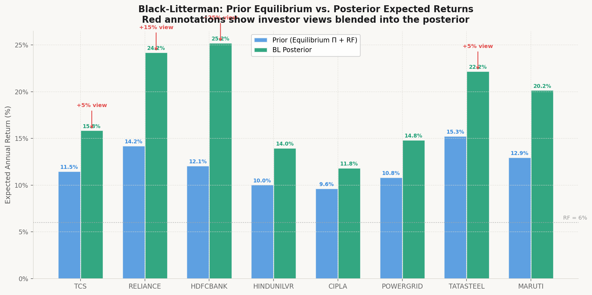
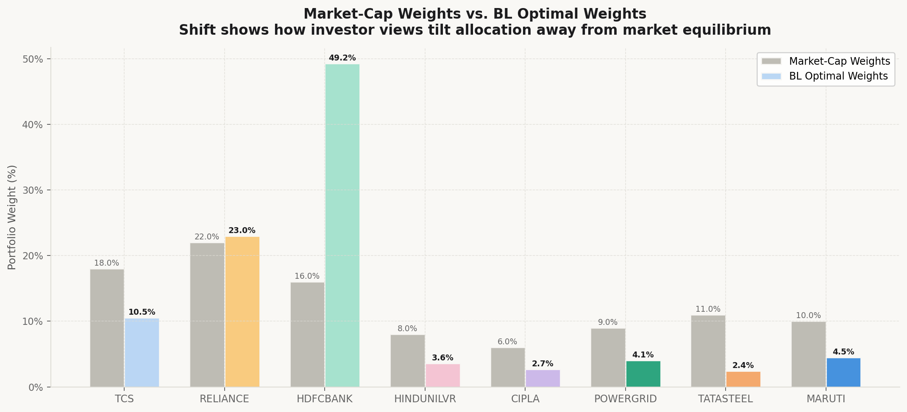
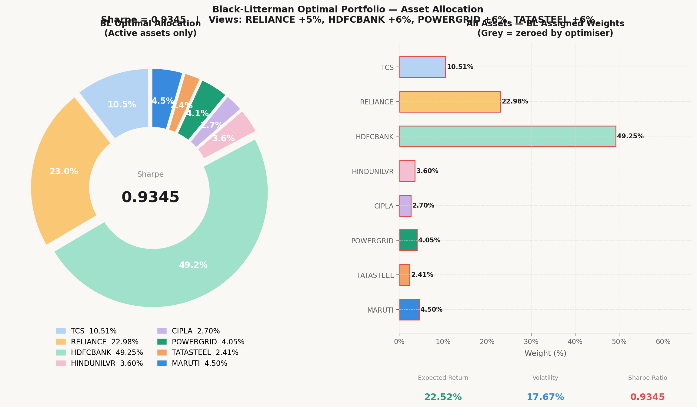
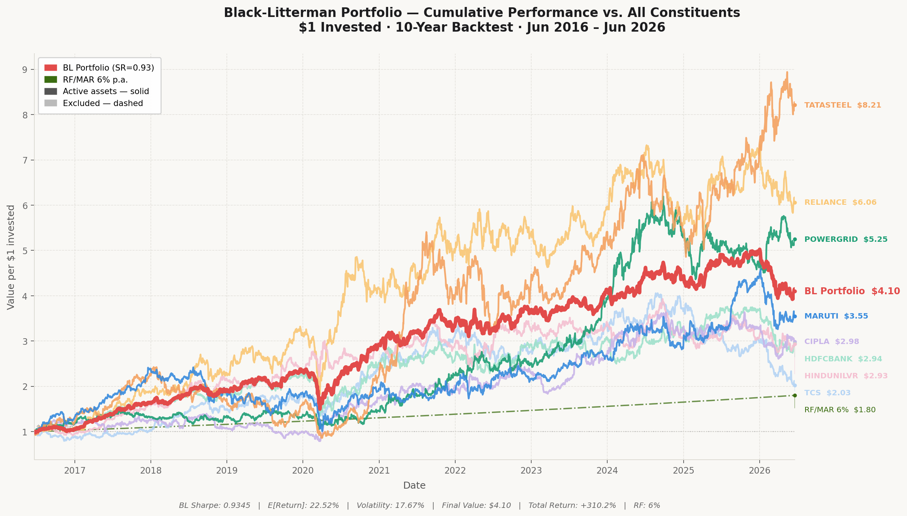

# Black-Litterman Portfolio Optimisation: Indian Large Caps

A Python implementation of the Black-Litterman (BL) model on eight NSE-listed large caps. It blends market-implied equilibrium returns with explicit investor views, runs a long-only max-Sharpe optimisation on the posterior, and compares the result with a market-cap-weighted portfolio and a 10-year price history.

**Universe:** TCS, Reliance, HDFC Bank, Hindustan Unilever, Cipla, Power Grid, Tata Steel, Maruti Suzuki
**Benchmark / data:** Nifty 50 (`^NSEI`), 10 years of daily adjusted closes via `yfinance` (Jun 2016 to Jun 2026)

---

## Why Black-Litterman

Plain mean-variance optimisation is very sensitive to expected-return estimates and tends to produce extreme, unstable portfolios. Black-Litterman starts from the returns implied by market-cap weights (the equilibrium), then tilts them only as far as your stated views and your confidence in them justify.

## Method

1. **Covariance.** Annualised sample covariance of daily returns, `Σ` (252 trading days).
2. **Equilibrium returns.** Reverse optimisation: `Π = δ · Σ · w_mkt`, with `δ = 2.5` and approximate free-float market weights as the market portfolio.
3. **Views.** Four absolute views, each expressed as equilibrium return plus an excess return. `P` is the picking matrix and `Q = Π_i + excess`.
4. **View uncertainty.** `Ω = diag(P · τΣ · Pᵀ)` with `τ = 0.05` (He-Litterman proportional specification).
5. **Posterior returns.** `μ_BL = [(τΣ)⁻¹ + Pᵀ Ω⁻¹ P]⁻¹ · [(τΣ)⁻¹ Π + Pᵀ Ω⁻¹ Q]`
6. **Posterior covariance.** `Σ_BL = Σ + M`, where `M = [(τΣ)⁻¹ + Pᵀ Ω⁻¹ P]⁻¹`.
7. **Optimisation.** Long-only, fully invested max-Sharpe (SLSQP) on `μ_BL + RF` and `Σ_BL`, risk-free rate `RF = 6%`. Weights below 0.1% are zeroed and the rest renormalised.
8. **Outputs.** 5,000 random Dirichlet portfolios for the frontier scatter, plus a cumulative-performance and drawdown backtest of the optimal weights.

### Investor views used

| Asset | View (excess over equilibrium return) |
|---|---|
| Reliance | +15% |
| HDFC Bank | +25% |
| TCS | +5% |
| Tata Steel | +5% |

These views are illustrative inputs to demonstrate the mechanics. They are not forecasts or recommendations.

## Results

### Prior vs posterior expected returns

| Asset | Prior (Π + RF) | BL posterior | Change | BL weight | Market weight |
|---|---:|---:|---:|---:|---:|
| TCS | 11.5% | 15.9% | +4.4% | 10.5% | 18% |
| Reliance | 14.2% | 24.2% | +10.0% | 23.0% | 22% |
| HDFC Bank | 12.1% | 25.2% | +13.2% | 49.3% | 16% |
| Hindustan Unilever | 10.0% | 14.0% | +3.9% | 3.6% | 8% |
| Cipla | 9.6% | 11.8% | +2.2% | 2.7% | 6% |
| Power Grid | 10.8% | 14.8% | +4.0% | 4.1% | 9% |
| Tata Steel | 15.3% | 22.2% | +6.9% | 2.4% | 11% |
| Maruti Suzuki | 13.0% | 20.2% | +7.2% | 4.5% | 10% |

### Optimal portfolio (model estimates, posterior)

| Metric | Value |
|---|---:|
| Expected return | 22.52% |
| Volatility | 17.67% |
| Sharpe ratio | 0.9345 |

These figures are **forward-looking model outputs** computed from the posterior returns and covariance. They are not realised performance.

### Historical backtest (in-sample, Jun 2016 to Jun 2026)

| Metric | Value |
|---|---:|
| $1 invested grows to | $4.10 (+310%) |
| Approximate annualised return | ~15.2% |
| Maximum drawdown | -37.1% (23 Mar 2020) |

The realised return is well below the 22.5% posterior expectation. That gap is expected: the expectation is driven by the views, which were inputs and not forecasts that came true.

### Charts

| | |
|---|---|
|  |  |
|  |  |

Interactive Plotly charts are in `BL_Outputs/`: `bl_4_efficient_frontier.html` and `bl_6_drawdown.html`. GitHub does not render HTML, so download them and open them in a browser.

## Quick start

```bash
git clone <https://github.com/abhinavkurra/Black-Litterman-Asset-allocation-Model>
cd <Black-Litterman-Asset-allocation-Model>
pip install numpy pandas scipy matplotlib seaborn plotly yfinance
python main.py
```

All outputs are written to `BL_Outputs/`:

| File | Content |
|---|---|
| `bl_1_prior_vs_posterior.png` | Prior vs posterior expected returns |
| `bl_2_weight_comparison.png` | Market-cap vs BL weights |
| `bl_3_allocation_donut.png` | BL allocation donut and bar |
| `bl_4_efficient_frontier.html` | Random portfolios and the BL max-Sharpe point |
| `bl_5_cumulative_performance.png` | BL portfolio vs each constituent |
| `bl_6_drawdown.html` | Underwater drawdown curve |
| `bl_7_metrics_table.csv` | Per-asset prior, posterior, volatility and weights |

Results depend on the date you run the script, because `yfinance` pulls the latest 10 years.

## Configuration

Edit the constants at the top of `main.py`:

| Parameter | Default | Meaning |
|---|---:|---|
| `TAU` | 0.05 | Uncertainty in the prior |
| `DELTA` | 2.5 | Market risk-aversion coefficient |
| `RF` | 0.06 | Risk-free rate |
| `VIEW_TICKERS`, `VIEW_EXCESS` | see above | Your views and their size |
| `mcap_weights_raw` | approximate | Market-portfolio weights |

## Limitations

- **In-sample backtest.** Weights are computed from the full 10-year covariance and then applied to the same period. There is no walk-forward test, rebalancing or transaction costs.
- **Views are assumed, not derived.** The views are hand-picked. The model shows how views move the portfolio, not whether they are right.
- **Concentration.** The optimiser has no position cap, so a strong view on HDFC Bank produces a ~49% weight. A maximum weight constraint would be more realistic.
- **Approximate market weights.** Market-cap weights are rounded estimates for this eight-stock universe, not true index weights.
- **Fixed parameters.** `τ` and `δ` are standard textbook-style choices and are not calibrated.
- **Survivorship and selection.** The eight stocks are current large caps chosen by hand.

## Possible extensions

- Walk-forward backtest with periodic rebalancing against the Nifty 50
- Maximum-weight and sector constraints
- Relative views (for example, HDFC Bank outperforms TCS) in addition to absolute views
- Sensitivity of weights to `τ`, `δ` and view confidence
- Live market-cap weights instead of fixed approximations

## Disclaimer

This project is for educational purposes only and is not investment advice.
